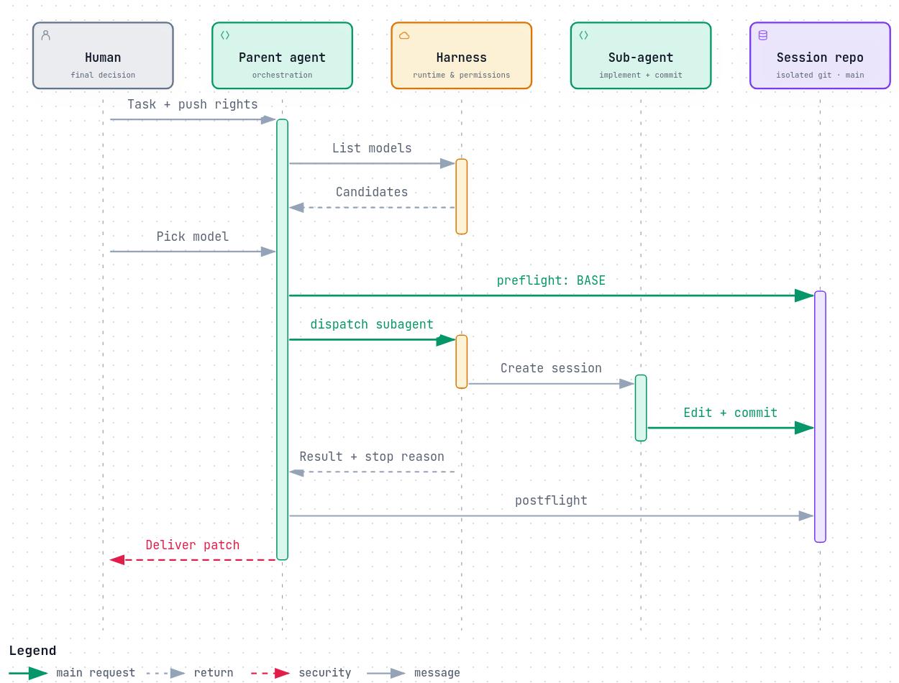

# git-task-bus

**English** · [中文](README.md)

Hand file-changing work to a cheap subagent: the parent freezes `BASE` and a path whitelist, the
subagent works and commits in an isolated git repository, and the parent only does mechanical
acceptance (diff + whitelist + test exit code) before handing back a patch you can roll back.

- Reads, failed attempts and test logs stay in the subagent's own session
- A failed check discards the work; the repository returns to where it started
- Every verdict lands in `MANIFEST.json` and the patch, so it can be audited later

Human-facing docs. The model-facing spec is [`git-task-bus/SKILL.md`](git-task-bus/SKILL.md).

## Install

The skill is the `git-task-bus/` directory. Copy it into a skills directory:

```bash
cp -r git-task-bus <workspace>/.dsh/skills/   # this workspace only
cp -r git-task-bus ~/.dsh/skills/             # every session on this machine
```

The model picks it up by `description`. Without an install it will not appear in the `skill` tool;
you can still read `SKILL.md` directly and replace `<skill dir>` with its real path.

## Quick start

```bash
SKILL=/path/to/git-task-bus

# 1. once per machine: check git, permissions and dependencies
bash "$SKILL/scripts/doctor.sh"

# 2. write the brief at tasks/t1/brief.md (goal, allowed paths, acceptance command, delivery rules)
#    then confirm the command itself runs:
#    "$SKILL/scripts/envcheck.sh" --tests '<command>'
#    0 or 1 is fine (a red baseline is expected); 3 means the command does not exist

# 3. create the repo and freeze BASE + whitelist
bash "$SKILL/scripts/preflight.sh" \
  --task t1 \
  --import src,test_src.py \
  --allow src \
  --tests 'python3 -m pytest -q test_src.py' \
  --model llama/LLaMA --quiet
```

```
PROMPT=.../repo/tasks/t1/dispatch.prompt
POINTER=read .../repo/tasks/t1/dispatch.prompt and follow it
MODEL=llama/LLaMA
```

4. Pass the `POINTER` line verbatim to the subagent (`cwd` = the repo), then end the turn.
5. After it commits, run acceptance:

```bash
bash "$SKILL/scripts/postflight.sh" --task t1 --child auto --quiet
# verdict=pass changed=1 violations=0 history=no dirty=0 testexit=0 patch=.../deliveries/t1.patch
```

Merge `deliveries/t1.patch` back if it passes. If it fails, the repo has already returned to
`BASE` and the changes are kept as `deliveries/t1.abandoned.patch`.

## How it works



Each horizontal arrow is one interaction; time runs downward. The model handshake is explicit:
the parent asks Harness for the available models, asks the human which one to use, `preflight`
freezes `BASE` and the whitelist, `subagent` has Harness create the child session, the subagent
commits on `main`, Harness returns the result and stop reason, the parent runs `postflight`, and
the patch goes to the **human** — merging, pushing and discarding are the human's call. The skill
never writes back to your tree.

[Interactive HTML](docs/flow-en.html): a self-contained single file. Open it locally, or enable
GitHub Pages in the repository settings to view it online.

There is one repository per conversation, with a single `main` branch; tasks are delimited by
`BASE` rather than by branches.

## Repository layout

```
<workspace>/
├── .gitignore              # if present: one line /<prefix>/session-*/ is appended, nothing overwritten
└── <session id>/
    └── repo/               # the session repo, single main branch
        ├── <source>        # writable by the subagent (whitelist)
        ├── model           # session-level model choice
        └── tasks/<task>/
            ├── brief.md        # single source of truth, committed by preflight
            ├── MANIFEST.json   # verdict and evidence
            └── deliveries/<task>.patch
```

When the workspace has no `.gitignore`, the skill leaves your repository alone and puts a
`*` ignore file inside the session directory instead.

Repository files:

```
git-task-bus/SKILL.md        spec the model reads
git-task-bus/references/     probe: three-layer check for a new environment or model
git-task-bus/scripts/        doctor / envcheck / preflight / postflight
git-task-bus/templates/      brief / probe / review / findings
tests/run.sh                 self-check (no network or subagent needed)
tests/audit_compliance.py    did the parent edit anything before dispatching?
usage_of.sh, usage_stats.sh  usage reader and rollup (not part of the skill)
subagent_test.md             measurements and design decisions
HISTORY.md                   development history
docs/flow-en.png             interaction timeline (English)
docs/flow-en.html            interactive version of the same diagram (single file)
README.md                    Chinese version
```

## Why use it

One line: **keep the reading, the dead ends and the failure logs in the child session, let the
parent receive only a verdict, and give that verdict a reader that was not primed by the parent's
assumptions.**

- **A clean parent context.** Files the subagent read, paths it tried, test logs — all stay in its
  own session. The parent sees one `postflight` line, the `git diff --stat` of a passing task, and
  the net diff only when a trigger fires. In long sessions most cost is context re-reading, so a
  short parent context is cheaper on every later step.
- **A second reader without the baggage.** The subagent only gets the frozen brief and `BASE`. It
  cannot see the assumptions of the previous dozens of turns, so it does not skip a check because
  "we already decided X". That matters most unattended, when nobody is around to correct course.
- **Rollback and traceability.** `BASE..HEAD` is exactly this task; the whitelist is compared after
  the fact; a failure is discarded automatically; the verdict and evidence stay in `MANIFEST.json`
  and the patch, so it can be reproduced later.

The trade-offs are real: the parent still pays for the brief and for orchestration (about 2,100 in
our measurements), so many tiny dispatches never pay off; the subagent's review can miss things,
so findings still need item-by-item checking; and "independent" means independent context, not a
permission boundary.

## When to use

All four have to hold:

1. The deliverable is a **file change** (code, data, config, or a document whose structure can be checked).
2. Acceptance can be **checked mechanically** (a test or script, not a human read).
3. The change needs **iteration** (first pass is usually not the last).
4. The subagent is **at least 3× cheaper** than the parent (`r ≤ 0.3`); a local model (`r = 0`) qualifies.

| ✅ Good fit | ❌ Poor fit |
|---|---|
| New implementation of 100+ lines, a single-file refactor | Checking state, reading files, one command |
| A 30–50 line change, or ten 10-line changes batched | A one-line change (orchestration costs about 2,100) |
| Bug fixes with a repro test | Model choice, copy, architecture trade-offs, research |
| Bulk mechanical edits (rename, migrate, format) | Tasks that need steering mid-flight |
| Unattended batch work | Interactive debugging (serial + async is slow) |
| A second opinion on a diff | Reviews purely to save tokens |

**Review-style work** can only be checked for structure and references (fields, anchors, links); it
cannot catch a wrong conclusion. Findings still need to be verified one by one. The same is true
for document deliverables: they are worth dispatching for a second read, not for token savings.

The savings below come from an extrapolated model, not from measurements per scenario:

| Scenario | `r = 0.1` (10× cheaper) | `r = 0` (local, free) |
|---|---|---|
| New implementation of 100+ lines | saves 73% | saves 79% |
| A 500-line task | saves 64% | saves 96% |
| A 30–50 line change | saves 35–64% | saves 44–73% |
| Ten 10-line changes, batched | saves 36% | saves 51% |
| Bulk mechanical edits | ✅ | ✅ |
| Review (second opinion) | more expensive (measured 109k–147k per run) | orchestration only |
| One-off script | too small to pay off | orchestration only |

`r` is the subagent price divided by the parent price. The measured break-even `r*` lands at
17–38%: the subagent has to be 3–6× cheaper to win. And `r = 0` is not free — it removes the
subagent's tokens, not the parent's turns:

```
a 10-line change done by the parent: 2,400
one task per turn:                  2,100 orchestration + amortization ≈ 2,443 → a loss
batch ten of them:                  about 210 each → saves 51%
```

**Batching is what pays, not a cheaper model.**

## Requirements

| Item | Requirement |
|---|---|
| OS | Linux · macOS · Windows (Git Bash or WSL) |
| git | ≥ 2.23 (needs `git switch`) |
| Commands | bash, POSIX basics, `python3` (hard dependency) |
| Workspace | writable; does not have to be a git repository |

Scripts only use POSIX tools plus `python3` (for `MANIFEST.json` and usage parsing); no `sort -V`,
`date -Iseconds` or `sha256sum` that BSD/macOS lacks. Content hashes use `git hash-object`.

On Windows: scripts must be LF (add `.gitattributes` or set `core.autocrlf=false`), and pass POSIX
paths (`/c/work/...`), not `C:\...`.

## FAQ

**Does it touch my own repository?**
No. All git operations happen in `<workspace>/<session id>/repo`; your repo is only read
(`--import` copies files). Discarding uses `git reset --hard` + `git clean -fd`, which would wipe
uncommitted and untracked files if run in your tree — that is exactly why the skill keeps its own
repo. When the workspace is itself a git repo, `preflight` keeps `<session id>/` out of `git status`:
if a `.gitignore` exists it appends one line (for example `/site/session-*/`) without touching the
existing rules; otherwise it drops a `*` ignore file inside the session directory. After an append
you will see `M .gitignore` — the only place the skill touches a workspace file; committing it is
your call.

**Should I delete the directory when the task is done?**
Delete `<workspace>/<session id>/` if you want it gone. The skill does not clean up automatically:
the directory keeps the patch, `MANIFEST.json` and the commit history used for audit and rollback.
It is ignored by any outer repository, so leaving it in place does not dirty `git status`.

**The subagent says the tests pass — can I trust it?**
No. `postflight` runs the acceptance command itself and records the exit code, and the parent runs
it once more. A self-report is not evidence.

**What if the subagent dies or runs out of budget?**
Pass the real stop reason with `--stop` (`aborted` / `error` / `max-tokens` / `refusal`); with
`--child` the tool also reads it from the session log. `max-tokens` means the task was too big —
narrow it or split it, don't re-dispatch unchanged.

**What do the exit codes mean?**
`0` pass · `1` test failure or abnormal stop reason · `2` violation (out of scope, rewritten
history, uncommitted delivery) · `3` configuration or environment error. Two similar failures in a
row usually mean the brief is unclear — fix the brief instead of trying a third time.

**How do I choose a model?**
The skill does not judge prices or pick for you. On first use, list the candidates and ask the
human, then persist the answer with `--model <provider/model> --save-model`. Resolution order:
`--model` > session repo `model` > `<workspace>/model`.

**How is subagent usage recorded?**
`--child auto` matches the child session through `parentSession` and reads its log into
`tasks/usage.tsv`; you can also pass `--usage 'steps=12,in=2689,out=1926,cache=143545'` by hand.
Reading depends on DSH session logs and zstd; if they are unavailable it only warns. `usage_stats.sh`
rolls up by model.

**What before a new environment or model?**
Run the three-layer probe in [`git-task-bus/references/probe.md`](git-task-bus/references/probe.md)
(doctor / envcheck / probe) to confirm the subagent commits, respects the whitelist and ends its
turn. Re-run it after updating the skill.

## Tests and measurements

```bash
bash tests/run.sh                    # 84 assertions, no network or subagent needed
SKIP_USAGE_TESTS=1 bash tests/run.sh # 54 when zstd is unavailable
```

Covers repo creation and commits, out-of-scope rejection, rollback on test failure, history-rewrite
detection, discard and archive, brief validation, minimal mode, portability, `--child auto` and
usage recording, the re-run guard, and patch paths.

Use `tests/audit_compliance.py` to check whether a session edited files before its first dispatch:

```bash
python3 tests/audit_compliance.py --session <session log> --scope code,static
```

Exit codes `0` compliant · `2` violation (lists steps and commands) · `3` no dispatch found.

What we measured (details in [`subagent_test.md`](subagent_test.md)):

- Seven dispatches of the same task took 11–86 subagent steps; the tail is decided by whether the
  first pass is right, and orchestration cannot remove it.
- The only A/B was a 16-line change: 213k doing it ourselves, 671k dispatched (with one failed
  re-dispatch) or 466k without it.
- Two reviews on real projects: 109k and 147k subagent tokens, 12 of 19 findings valid, two
  high-impact issues missed.

## Development cost (this repository)

The development and validation happened in a single parent session. Snapshot (read on 2026-11-23,
still growing):

| Item | Value |
|---|---|
| Steps | 1,161 |
| Turns | 297 (275 human inputs) |
| Uncached input | 1,800,513 tok |
| Cache reads | 462,736,896 tok |
| Output | 1,035,114 tok |
| Cache hit rate | 99.61% |
| Weighted cost (input 1 / cache 0.02 / output 4) | 15,195,707 |

This is the **cost of building the tool and running the experiments**, not the cost of using it:
99.61% of the tokens are the same growing context re-read on every step (about 399k per step,
against 1,551 tok of new input). It shows the cost structure of a long session — a single task's
savings get drowned by that fixed context, so the skill has to be judged over many tasks.

## License

[AGPL-3.0](LICENSE)

---

[English](README.en.md) · [中文](README.md)
