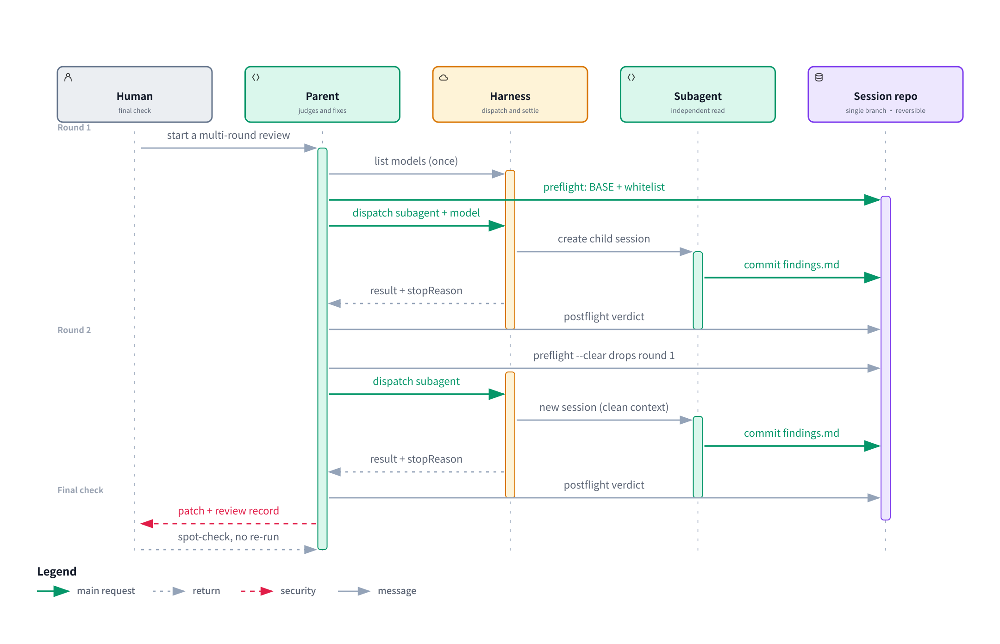

# subagent-delegation

**English** · [中文](README.md)

This skill uses git to manage the handoff between parent and subagent: **the parent keeps its own
context, while the subagent starts from an independent context and does not inherit whatever
biases and blind spots may be there** — one repository per conversation, the parent freezes
`BASE` and a path whitelist, the subagent commits on `main`, and the parent accepts mechanically
with diff, whitelist and test exit code, rolling back and archiving a patch on failure.
The delivery is therefore **rollbackable and auditable**, and the review is not primed by the parent
context; when the subagent is clearly cheaper (low `r`) on a large enough task it also **saves
tokens**.

This document is the user-facing guide; the model-facing spec is
[`subagent-delegation/SKILL.md`](subagent-delegation/SKILL.md).

> ⚠️ **Serial, no concurrency**: one subagent at a time — dispatch, wait for the commit and
> acceptance, then dispatch the next; multiple rounds can be driven unattended.

## ✨ Why use it

- **Rollback and traceability.** `BASE..HEAD` is exactly this task; the whitelist is compared after
  the fact; a failure is discarded automatically; the verdict and evidence stay in `MANIFEST.json`
  and the patch, so it can be reproduced later.
- **A second reader, within limits.** The subagent does not inherit the parent conversation: it gets
  the frozen brief and a repo snapshot, so it does not skip a check because "we already decided X".
  The repo itself may still hold previous tasks and last round's `findings.md`; real independence
  depends on clearing those (`preflight --clear findings.md`; history and the patch still keep the
  evidence). It can find invariants the parent missed, but its findings must be verified, not treated
  as a backlog.
- **The parent keeps its context; the subagent judges independently.** Files the subagent read,
  paths it tried and test logs all stay in its own session. The parent reads the `postflight`
  summary, the `git diff --stat` of a passing task, and the net diff only when a trigger fires. In
  long sessions most cost is context re-reading, so a parent context that does not grow with each
  dispatch is lighter on every later step.

⚠️ **The trade-offs are real**: the parent still pays for the brief and for orchestration (about
2,100); reviews usually cost more; the subagent's review can miss things, so findings still need
item-by-item checking; and "independent" only means independent context — the child runs with the
same uid and filesystem, and the boundary is a whitelist over **committed paths** in the session
repo, so files outside it or ignored by `.gitignore` are not contained. Real isolation needs the
harness sandbox. Token savings depend on `r`, task size and batching — see below.

## 📦 Install

### Requirements

| Item | Requirement |
|---|---|
| OS | Linux · macOS · Windows (Git Bash or WSL) |
| Harness | DeepSeek Harness v0.2.2 (session v4 logs); `--child` reads them and is required |
| git | ≥ 2.28 (July 2020) |
| Commands | bash, POSIX basics, `python3` (hard dependency) |
| Workspace | writable; does not have to be a git repository |

The acceptance logic only uses POSIX tools plus `python3` (for `MANIFEST.json` and usage parsing);
no `sort -V`, `date -Iseconds` or `sha256sum` that BSD/macOS lacks. Decompressing child logs calls
the system `zstd` command: DSH's zstd codec runs in-process and provides no command, so this is an
external dependency, and `doctor.sh` checks it. Content hashes use `git hash-object`. On the git side it uses the 2.28 commands directly:
`git init -b`, `git switch`, `git worktree list`; no compatibility branches for older releases.

On Windows: scripts must be LF (add `.gitattributes` or set `core.autocrlf=false`), and pass POSIX
paths (`/c/work/...`), not `C:\...`.

Another harness only needs the child-session adapter replaced: see "Porting to another harness"
below.

### Copy into the skills directory

The skill is the `subagent-delegation/` directory. Copy it into a skills directory:

```bash
cp -r subagent-delegation <workspace>/.dsh/skills/   # this workspace only
cp -r subagent-delegation ~/.dsh/skills/             # every session on this machine
```

The model picks it up by `description`. Without an install it will not appear in the `skill` tool;
you can still read `SKILL.md` directly and replace `<skill dir>` with its real path.

### Self-check

```bash
bash subagent-delegation/scripts/doctor.sh
```

It names anything missing.

## 🚀 Usage

One sentence is enough: the skill, the target, what to do, and when to stop.

Single dispatch:

> Use the subagent-delegation skill to <do something> to <the target>. Wait for my confirmation when done.

Multi-round, unattended:

> Use the subagent-delegation skill to <do something> to <the target> for <N> consecutive rounds.
> Wait for my confirmation when done.

The user only needs to read the report the parent provides: the verdict per round (accepted /
rejected / why), the diff and test results, and anything that needs a decision. The subagent's
process and self-report do not need reading — the parent freezes the acceptance test before dispatch
and re-runs it itself, never trusting the subagent's self-report. Command syntax, the brief format
and `--allow-no-tests` live in [`SKILL.md`](subagent-delegation/SKILL.md), the spec for the model.

## 🎯 When to use

Three signals — the more of them hold, the better the fit, but they do not all have to:

1. The deliverable is a **file change** (code, data, config, or a document whose structure can be checked).
2. Acceptance can be **checked mechanically**, without a human read — tests or a script's exit code
   for code, structure and references (fields, anchors, links) for review and report deliverables.
3. The change needs **iteration** — the first pass is usually not the last.

If none hold, don't dispatch (checking state, choosing a design, a one-line edit); a large change that
hits all three is the best case; everything in between is in the table below.

| ✅ Good fit | ❌ Poor fit |
|---|---|
| — | **Needs concurrency (the skill is serial)** |
| New implementation of 100+ lines, a single-file refactor | Checking state, reading files, one command |
| A 30–50 line change, or ten 10-line changes batched | A one-line change or a new constant (orchestration costs about 2,100) |
| Bug fixes with a repro test | Model choice, copy, architecture trade-offs, research |
| Bulk mechanical edits (rename, migrate, format) | Tasks that need steering mid-flight |
| Unattended batch work, or serial multi-round edits/reviews | Interactive debugging (serial + async is slow) |
| A second opinion (clean-context review, diff or not) | Reviews purely to save tokens |

### Serial, but multi-round

One subagent at a time: dispatch, wait for the commit and acceptance, then dispatch the next. The
parent can drive unattended multi-round edits or reviews this way, still freezing, dispatching and
accepting each round, with automatic rollback on failure.

### The verdict is reached in-round, attended or not

What the subagent returns is findings, not a verdict: the parent gives each one a level, evidence, a
decision and a reason, lands accepted ones as commits and tests, and keeps rejected ones comparable
against the original `findings.md`. What the human reviews afterwards is the **record plus spot
checks** — the diff and tests of accepted items, and a few rejections against the original — not a
re-run. The judgment is not skipped; it moves from the human to the parent and from process time to
result time.

### Review and document work

Only the structure and references of a report (fields, anchors, links) can be checked mechanically,
and that does not stop a wrong conclusion — findings still need to be verified one by one. Worth
dispatching for a second read, usually not for token savings.

## 💰 When token savings are possible (`r`)

`r` is the subagent price divided by the parent price. Cost-model extrapolation puts break-even `r*`
at 26–38% for new 100-line work (down to ~17% extrapolated): the subagent has to be 3–4× cheaper
before a single dispatch can win. Iterative small edits are another order of magnitude; see the full
threshold table in `subagent_test.md`. Whether it actually saves also depends on task size and batching.

| `r` | May save when | Extrapolated |
|---|---|---|
| `r = 0` (free on the subagent side) | 100+ lines, 500-line tasks, bulk mechanical edits, ten 10-line changes batched | 100+ lines: 79%; 500 lines: 96%; ten batched: 51% |
| `0 < r ≤ 0.1` | 100+ lines, batched work | 100+ lines: 73%; ten batched: 36% (iterative edits have their own threshold in `subagent_test.md`) |
| `0.1 < r ≤ 0.3` | Large or batched work; medium changes approach break-even | 100-line tasks can still win; a single 10-line change usually loses |
| `0.3 < r ≤ 0.38` | Only very large or batched work may break even | Near the break-even line; measure actual steps |
| `r > 0.38` | Usually not dispatched for savings | The value shifts to audit, isolation and rollback |

`r = 0` is not free — it removes the subagent's tokens, not the parent's turns:

```
a 10-line change done by the parent: 2,400
one task per turn:                  2,100 orchestration + amortization ≈ 2,443 → a loss
batch ten of them:                  about 210 each → saves 51%
```

### Batching is what pays, not a cheaper model

A single task pays the orchestration first, and only batching amortizes it; a cheaper model (lower
`r`) is a different lever, not a substitute. Review and document work usually fails the savings
test; what you get is a second independent read.

### Dispatching the same model (`r ≈ 1`)

Not in that table — it buys no savings, only an independent pair of eyes and a rollbackable delivery. A workable split: hand mechanical and surface-level changes
to the cheap model, and keep verdict logic, adapters and audit completeness — the places where a
mistake stays silent — for a stronger model, including a same-model subagent. Either way the same
model tends to inherit the parent's blind spots, so verify findings item by item; and across
unattended rounds the cost adds up linearly, so budget the rounds before starting.

## ⚙️ How it works


Each horizontal arrow is one interaction; time runs downward. The model handshake is explicit:
the parent asks Harness for the available models, asks the human which one to use, `preflight`
freezes `BASE` and the whitelist, `subagent` has Harness create the child session, the subagent
commits on `main`, Harness returns the result and stop reason, the parent runs `postflight`, and
the patch goes to the **human** — merging, pushing and discarding are the human's call. The skill
never writes back to your tree.

[Interactive HTML](docs/flow-en.html): a self-contained single file. Open it locally, or enable
GitHub Pages in the repository settings to view it online.

### Multi-round review (unattended)



The multi-round version draws the loop: each round freezes `BASE` and the whitelist, dispatches,
the subagent commits `findings.md`, and `postflight` judges it; the next round starts with
`--clear findings.md`, dropping the previous artifact before freezing a new `BASE` (if the last
round failed and the file is already gone, it is skipped). The parent
accepts or rejects every finding with a reason and lands the fixes in-round; the human only reads
the patches and review record at the end and spot-checks. [Interactive](docs/flow-multi-en.html).

There is one repository per conversation, using only the `main` branch; tasks are delimited by
`BASE` rather than by branches. `preflight` checks out `main` every time; any other branch in the
repo takes no part in dispatch or acceptance (and is not deleted).

## 🗂️ Repository layout

```
<workspace>/
└── <session id>/
    └── repo/               # the session repo, single main branch
        ├── <source>        # writable by the subagent (whitelist)
        ├── model           # session-repo-level model choice
        ├── tasks/imports.tsv  # global import index (contentHash across tasks)
        └── tasks/<task>/
            ├── brief.md        # single source of truth, committed by preflight
            ├── MANIFEST.json   # verdict and evidence
            └── deliveries/<task>.patch
```

When the workspace is inside another git repo, `preflight` adds `/<session id>/` to that repo's
`.git/info/exclude` (`/subdir/<session id>/` when the workspace is a subdirectory). That is git's
local ignore file: it is not versioned, your `.gitignore` stays untouched, and `git status` gains
no entry. If `.git` is not writable it falls back to a `*` ignore file in the session directory.

## 🔌 Porting to another harness

The acceptance core (`preflight`/`postflight`: diff, whitelist, history, tests, patch, MANIFEST,
rollback) only needs git + bash + `python3`. DSH appears only as the **child-session adapter** plus
two environment inputs (`DSH_SESSION_ID`, `DSH_HOME`).
Porting means replacing that adapter; the verdict logic does not change.

### What the adapter provides

| Capability | Source on DSH | When unreadable |
|---|---|---|
| child session id | not available model-side: `subagent` returns only a name and so does the settlement notice; `--child auto` matches the child log's first line by `parentSession` + `createdAt` | `childSession=null` |
| stopReason | `reason.kind` of the last `turn/end` in the child log | falls back to `--stop` (default `completed`) |
| usage | `assistant/message.usage`: `inputTokens` / `outputTokens` / `cacheReadTokens`, summed per step | not recorded; `--usage` can be passed by hand |

- **stop is a verdict latch**: anything other than `completed` fails, so a truncated delivery cannot
  pass just because tests happen to be green.
- **unreadable `--child` logs fall back to `--stop`**: when the explicit id has no log, `auto` matches
  no child session, or the log has no `turn/end`, `postflight` warns that stop correction was
  skipped and uses `--stop` as given (or `completed` if omitted). Pass the correct `--stop`
  explicitly if you need a trustworthy verdict. If the child session is reused for later chat, its log
  holds several `turn/end` events and the last one wins — pass `--stop` explicitly in that case.
- **usage is audit-only**: it lands in `tasks/usage.tsv` (MANIFEST records only `childSession` and
  `stopReason`) and does not affect the verdict; use `usage_of.sh` or explicit `--usage` when
  measuring `r`.
- **The DSH settlement notice is not a substitute**: the parent gets prose (`finished`, `was stopped
  before it finished`, `ran out of room`), the text carries no id, and the exact `stopReason` lives
  only in metadata no script can read. The adapter reads the log for the exact enum and `childSession`.
- **The log suffix follows DSH config**: `session.v4.jsonl.zstd` with `compression: zstd`,
  `session.v4.jsonl` with `none`; the adapter accepts both and only decompresses the former. That
  decompression calls the system `zstd` command, which `doctor.sh` checks; without it, switch DSH to
  `compression: none`, or stop correction fails and the verdict falls back to `--stop` (or
  `completed`), with a "log unreadable" warning.

Order of magnitude: one child-log read ~20ms; `--child auto` scans first lines in ~0.8s; explicit id
~30ms; reading the parent log's `subagent/catalog` (the other id source) ~0.66s. `auto` spends its
time finding the id, not parsing.

### Porting checklist

| Where | DSH-specific | Replace with |
|---|---|---|
| `postflight.sh`'s `child_log` / `resolve_child` / `read_child_meta` | log path, `parentSession`, `turn/end`, `usage`, zstd | the target harness's session store and parser; keep the "return stop/usage" interface |
| `--child auto` | matching by parent session + `createdAt` | if the harness exposes the child id, drop `auto` and pass the id |
| stopReason values | `completed` / `aborted` / `max-tokens` / `error` / `refusal` | map to the target harness's stop reasons; the verdict still accepts only `completed` |
| `--usage` format | `steps=..,in=..,out=..,cache=..` | rename fields, or keep this string format for the parent to pass by hand |
| `DSH_SESSION_ID` / `DSH_HOME` / `CREATED` in `dispatch.env` | locating the parent, matching the child | the target harness's equivalents; if none, require an explicit `--child <id>` |
| `doctor.sh` | checks git / python3 / zstd | adjust it when the target uses another decompressor |

The log format is tied to DSH v0.2.2's session v4; if it changes in a DSH upgrade, update the adapter.

### Harness without session logs

Minimal change, in two steps:

1. delete the three adapter functions and the `--child` parsing, including the `--child` required
   check in argument parsing;
2. delete the `completed` default for `--stop` and make it required — missing log correction plus a
   missing explicit declaration is a double fail-open.

Keep `--usage` manual only and set MANIFEST's `childSession` to `null`. The acceptance logic is
unchanged.

### Verifying on the target harness

Every postflight call in `tests/run.sh` passes `--child test-child` with no matching log, which
covers the "log unreadable" fallback (use `--stop` if given, otherwise the `completed` default).
To verify an adapter on another harness, add a minimal session-log fixture.

## ❓ FAQ

### Does it touch my own repository?
No. All git writes happen in `<workspace>/<session id>/repo`; nothing tracked in your repo is
written (`--import` only reads files). Discarding uses `git reset --hard` + `git clean -fd`, which would wipe
uncommitted and untracked files if run in your tree — that is exactly why the skill keeps its own
repo. When the workspace is itself a git repo, `preflight` keeps `<session id>/` out of `git status`
by adding `/<session id>/` to `.git/info/exclude` (git's local ignore file, never versioned). Your
`.gitignore` is not modified and no `M .gitignore` appears; a subdirectory workspace uses
`/subdir/<session id>/`.

### Why not just `git init` manually?
`preflight` also writes the session repo's `.gitignore`, the outer `.git/info/exclude` (falling
back to a session-dir `.gitignore`), and the `model` config, then makes the plan commit and freezes
`BASE`. A manual init misses those, so `postflight` loses the basis for its `BASE`, whitelist and
dirty-tree checks.

### Should I delete the directory when the task is done?
Delete `<workspace>/<session id>/` if you want it gone. The skill does not clean up automatically:
the directory keeps the patch, `MANIFEST.json` and the commit history used for audit and rollback.
It is ignored by any outer repository, so leaving it in place does not dirty `git status`.

### How do I undo the ignore rule?
Delete the two lines `preflight` appended to `.git/info/exclude`: the comment line (new runs write
`# subagent-delegation session workspaces`, older ones wrote `# git-task-bus session workspaces`) and
`/<session id>/`. Afterwards the session directories show up in `git status` again.

### The subagent says the tests pass — can I trust it?
No. `postflight` runs the acceptance command as the parent and records the exit code. A
self-report is not evidence.

### What if the subagent dies or runs out of budget?
Pass the real stop reason with `--stop` (`aborted` / `error` / `max-tokens` / `refusal`);
`postflight` also corrects it from the child-session log. `max-tokens` means the task was too big —
narrow it or split it, don't re-dispatch unchanged.

### Does the acceptance command run sandboxed?
No: `--tests` runs as the calling user inside the session repo. Treat it as executable shell code;
do not paste commands from untrusted sources.

### What do the exit codes mean?
`0` pass · `1` test failure or abnormal stop reason · `2` violation (out of scope, rewritten
history, uncommitted delivery, or HEAD not on `main`) · `3` configuration or environment error. Two similar failures in a
row usually mean the brief is unclear — fix the brief instead of trying a third time.

### How do I choose a model?
The skill does not judge prices or pick for you. On first use, list the candidates and ask the
human, then persist the answer with `--model <provider/model> --save-model`. Resolution order:
`--model` > session repo `model` > `<session-dir>/model` > `<workspace>/model`; with none of
them `preflight` exits 3 instead of silently falling back to the parent model.

### How is subagent usage recorded?
`--child auto` matches the child session through `parentSession` and reads stop/usage from the
DSH log into `tasks/usage.tsv` (usage is audit-only and does not affect the verdict); `--child` is
required. You can also pass
`--usage 'steps=12,in=2689,out=1926,cache=143545'` by hand to skip automatic reading.
`usage_stats.sh` rolls up by model.

### What before a new environment or model?
Run the three-layer probe in [`subagent-delegation/references/probe.md`](subagent-delegation/references/probe.md)
(doctor / envcheck / probe) to confirm the subagent commits, respects the whitelist and ends its
turn. Re-run it after updating the skill.

## 🧪 Tests

```bash
bash tests/run.sh                    # 193 assertions, no network or subagent needed
# needs zstd (DSH compresses logs by default); it fails fast without it — run scripts/doctor.sh
```

Covers repo creation and commits, out-of-scope rejection, rollback on test failure, history-rewrite
detection, discard and archive, brief validation, minimal mode, portability, `--child auto` and
usage recording, the `--stop` default, the re-run guard, and patch paths.

Use `tests/audit_compliance.py` to check whether a session edited files before its first dispatch:

```bash
python3 tests/audit_compliance.py --session <session log> --scope code,static
```

Exit codes `0` compliant · `2` violation (lists steps and commands) · `3` no dispatch found.

## 📊 Development cost (this repository)

Development and validation happened in a single parent session; subagent usage is summed from the
session logs by `parentSession`. Snapshot (read on 2026-11-24, still growing):

| Item | Human | Parent | Subagents |
|---|---|---|---|
| Input | 436 messages | — | — |
| Time | 8 days 15 hours | 6.2 hours in 475 turns | 3.9 hours over 52 sessions |
| Steps | — | 2,995 | 2,296 |
| Turns | — | 475 | 52 sessions (9 of them same-model) |
| Uncached input | — | 2,863,403 tok | 2,556,383 tok |
| Cache reads | — | 866,122,112 tok | 164,004,057 tok |
| Output | — | 2,329,029 tok | 862,932 tok |
| Cache hit rate | — | 99.67% | 98.47% |
| Weighted cost (input 1 / cache 0.02 / output 4) | — | 29,501,961 | 4,339,885 (only the 9 same-model runs: 600,656 + 226,610 + 2,317 + 664,989 + 612,197 + 220,741 + 1,122,749 + 481,069 + 408,557; the other 43 at `r = 0`) |

### Division of labour

- **The human**: sets the principles and acceptance criteria, corrects errors, makes the calls
  (fix / don't dispatch / push), asks for a measurement first, and often dictates the change itself
  — which section, what wording, which name; the implementation and verification are the parent
  agent's.
- **The parent agent**: implements, designs controlled experiments, digs facts out of session logs,
  writes the docs, runs the self-checks. Typical failures: drifting definitions (a changed multiplier
  that is not recomputed) and treating assumptions as conclusions.

## 📄 License

[AGPL-3.0](LICENSE)

---

[English](README.en.md) · [中文](README.md)
