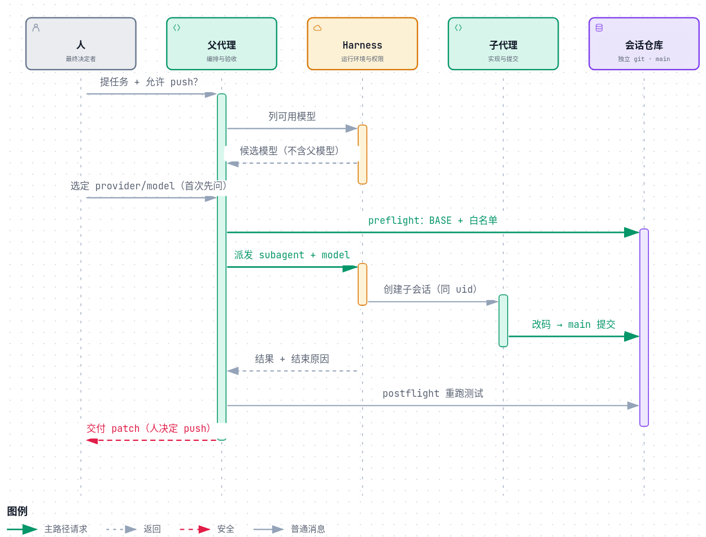

# git-task-bus

**中文** · [English](README.en.md)

把会改文件的活派给子代理，用 git 换**可回滚、可审计**的交付：父代理冻结 `BASE` 与路径白名单，
子代理在独立仓库里干活并提交，父代理做机械验收（diff + 白名单 + 测试退出码），最后收下
可复查的 patch。

- 不通过就自动丢弃，仓库回到派发前，不留半成品
- 每次判定都写进 `MANIFEST.json` 和 patch，事后能复查
- 子代理读的文件、失败的尝试、测试日志都留在它自己的会话里

> **Harness 版本**：本技能基于 DeepSeek Harness **v0.2.2** 开发和验证；`--child` 依赖 DSH
> 子会话日志，是必需项。其他 harness 需要重写该适配器，见[移植到其他 harness](#移植到其他-harness)。

给**人**看的说明。给模型读的规范在 [`git-task-bus/SKILL.md`](git-task-bus/SKILL.md)。

## 安装

技能本体就是 `git-task-bus/` 目录，拷到 skills 目录即可：

```bash
cp -r git-task-bus <workspace>/.dsh/skills/   # 仅本工作区
cp -r git-task-bus ~/.dsh/skills/             # 本机所有会话（会影响全局 catalog）
```

放好后模型会按 `description` 自动匹配并使用。没有安装时，`skill` 工具里不会出现它——
这时可以直接读 `SKILL.md`，把文中的 `<本技能目录>` 换成实际路径。

## 快速开始

```bash
SKILL=/path/to/git-task-bus

# 1. 每台机器一次：确认 git、权限、依赖命令
bash "$SKILL/scripts/doctor.sh"

# 2. 写简报 tasks/t1/brief.md（目标、允许改动的范围、验收命令、交付要求）
#    写完用 "$SKILL/scripts/envcheck.sh" --tests '<命令>' 确认命令能跑：
#    0 或 1 都正常（基线红是预期的），3 表示命令根本不存在

# 3. 建仓库、冻结 BASE 与白名单
bash "$SKILL/scripts/preflight.sh" \
  --task t1 \
  --import src,test_src.py \
  --allow src \
  --tests 'python3 -m pytest -q test_src.py' \
  --model llama/LLaMA --quiet
```

```
PROMPT=.../repo/tasks/t1/dispatch.prompt
POINTER=读 .../repo/tasks/t1/dispatch.prompt 并按其执行
MODEL=llama/LLaMA
```

这里的测试由父代理先写、派发前冻结：验收命令写进简报，测试文件用 `--import` 拷进仓库，但
**不要放进 `--allow`**——子代理只能改实现，改了测试就是越界。`postflight` 最后以父代理身份
重跑同一条命令，不采信子代理的自述。修 bug 时基线测试可以是红的（`envcheck` 返回 1），
派发后必须转绿。

评审/文档类如果没有可机械检查的结构，用 `--allow-no-tests` 显式声明，并在简报里写「人工核对」；
否则 `preflight` 以 exit 3 拒绝。这样“没有验收命令”会成为 MANIFEST 里可见的状态（`testsRun=false`），
而不是静默通过。

4. 把 `POINTER` 那一行原样交给子代理（`cwd` = 仓库路径），然后结束回合。
5. 子代理提交后验收：

```bash
bash "$SKILL/scripts/postflight.sh" --task t1 --child auto --stop completed --quiet
# verdict=pass changed=1 violations=0 history=no dirty=0 testexit=0 patch=.../deliveries/t1.patch
```

通过就把 `deliveries/t1.patch` 合回主树；不通过时仓库已经回到 `BASE`，改动存为
`deliveries/t1.abandoned.patch` 供事后查看。判定降级为 `error` 时 patch 存为
`deliveries/<task>.error.patch`，并写一份兜底 `MANIFEST.json`。

## 工作原理



图上一条横向箭头是一次交互，纵轴是时间。关键的三段都画出来了：父代理先向 Harness 要可用模型、
再问人用哪个，`preflight` 冻结 `BASE` 与白名单，`subagent` 派发后由 Harness 创建子会话，
子代理在 `main` 上提交，Harness 把结果与结束原因交回父代理，父代理跑 `postflight` 验收，
最后 patch 交给**人**——合并、push、丢弃都由人执行，技能不写回主树。

[交互版 HTML](docs/flow-zh.html)：自包含单文件，可在本地打开，或在仓库设置里开启 GitHub Pages 后直接访问。

每对话一个仓库，从头到尾只有 `main` 一条分支；任务不建分支，靠 `BASE` 划分。

## 目录结构

```
<工作区>/
└── <会话 id>/
    └── repo/               # 会话仓库，单分支 main
        ├── <源码>          # 子代理可改（白名单内）
        ├── model           # 会话仓库级模型选择
        ├── tasks/imports.tsv  # 全局导入索引（跨任务 contentHash）
        └── tasks/<task>/
            ├── brief.md        # 规格唯一来源，preflight 提交
            ├── MANIFEST.json   # 判定与证据
            └── deliveries/<task>.patch
```

工作区在别的 git 仓库内时，`preflight` 把 `/<会话 id>/` 追加进该仓库的 `.git/info/exclude`
（工作区是子目录时是 `/子目录/<会话 id>/`）。那是 git 的本地忽略文件：不进版本控制、不改你的
`.gitignore`、`git status` 也不会多出任何条目。`.git` 不可写时退回在会话目录里放一个 `*`。

仓库清单：

```
.gitattributes               LF 换行约束（Windows 检出）
git-task-bus/SKILL.md        模型读的规范与流程
git-task-bus/references/     probe：首次换环境或换模型时的三层探测
git-task-bus/scripts/        doctor / envcheck / preflight / postflight
git-task-bus/templates/      brief / probe / review / findings
tests/run.sh                 自检（无需网络或子代理）
tests/audit_compliance.py    合规审计：派发前有没有先动手（write/edit/apply_patch + 常见 bash 写模式）
usage_of.sh, usage_stats.sh  用量读取与汇总（不属于技能本体）
subagent_test.md             实测记录与设计决策
HISTORY.md                   开发史与角色记录
docs/flow-zh.png             协作时序图（中文）
docs/flow-zh.html            同一张图的交互版（自包含单文件）
README.en.md                 English version
```

## 为什么值得用

一句话：**先把交付做成可回滚、可追溯的，再让它经过一个没被父上下文带偏的读者；省 token 是
条件收益，不是默认收益。**

- **可回滚、可追溯**：`BASE..HEAD` 就是本次改动，不多不少；白名单事后比对；不通过自动丢弃；
  判定和证据落在 `MANIFEST.json` 与 patch 里，事后能复现。
- **独立复核**：子代理只拿到冻结的简报和 `BASE`，看不到前面的假设与结论，不会被「我们已经
  确定 X」带偏。多轮自举的报告里，父代理逐条复现后约四成成立——它能发现父代理忽略的不变量，
  但结论必须自己核对，不能直接当 backlog。
- **上下文隔离**：子代理读的文件、走过的弯路、测试日志都在它自己的会话里；父代理只看
  `postflight` 的一行结论，需要时再看 `git diff --stat` 或净 diff。长会话的开销主要来自上下文
  重读，父上下文保持短小，后续每一步都更轻。

代价也要算进去：父代理仍要付简报与验收的编排费（约 2,100）；评审类通常更贵；子代理的复核
会漏，结论仍要逐条核对；「独立」是上下文独立，不是权限隔离。省 token 的条件见下一节。

## 什么时候用

用户明确要求派发时，直接派；明确要求不派时，不派。用户没表态时，父模型按下面的条件自主判断，
不必逐次询问：按前三条决定是否适合派，第 4 条决定这次是否也省 token。

1. 交付是**文件改动**（代码、数据、配置，或结构可校验的文档）；
2. 验收能**机械核对**（测试或脚本能判对错，不靠人读）；评审/报告类没有机械判据时用
   `--allow-no-tests` 声明，结论由父代理逐条核对；
3. 改动要靠**迭代收敛**（一次写不对，要多轮）；
4. 若目标是省 token：`r` 越低越好；大任务/批量约 `r ≤ 0.3`，`r > 0.38` 通常只为审计、不为省钱。
   本地部署（`r = 0`）自动满足省钱条件，但单发小改仍可能亏在编排上。

| ✅ 适合 | ❌ 不适合 |
|---|---|
| 100 行以上新实现、单文件重构 | 查状态、读文件、跑一条命令 |
| 30–50 行改动，或 10 行小改攒批 | 改一行、加个常量（编排成本约 2,100） |
| 有复现测试的 bug 修复 | 选型、文案、架构取舍、调研 |
| 批量机械改动（改名、迁移、格式化） | 需要中途给方向的任务（简报冻结是前提） |
| 无人值守的批处理，或串行多轮修改/审查 | 交互式调试（串行 + 异步，来回很慢） |
| 第二意见评审（干净上下文的复核，不限于 diff） | 评审只为省 token（结论仍要逐条核对） |
| | 需要并发（技能本身是串行的） |

**并发与多轮**：技能本身是串行的——一次只派一个子代理，等它提交并验收后再派下一个。可以由
父代理无人值守地串行驱动多轮修改/审查：每轮仍走 preflight → 派发 → postflight，失败自动回滚；
不能并发派发，也不替父代理判断评审结论是否正确。

**评审类**只能机械核对报告的结构与引用（字段、锚点、链接），拦不住错误结论，派发后结论仍要
父代理逐条核对；没有可检查的结构时用 `--allow-no-tests` 声明并在简报写明人工核对。
**文档/报告类**同理：可以派，但换来的是第二遍独立阅读，不是省 token。

## 省 token 的条件（r）

`r` 是子代理价格与父代理价格之比。实测盈亏平衡 `r*` 落在 26–38%（100 行级任务外推下限约
17%）：子代理要比父代理便宜 3–4 倍，单发任务才可能省。是否真的省，还取决于任务规模和是否攒批。

| `r` | 可能省 token 的情形 | 外推估计 |
|---|---|---|
| `r = 0`（本地免费） | 100 行以上、500 行级、批量机械改动、10 个 10 行小改攒批 | 100+ 行省 79%；500 行省 96%；10 个 10 行攒批省 51% |
| `0 < r ≤ 0.1` | 100+ 行、30–50 行、批量 | 100+ 行省 73%；30–50 行省 35–64%；10 个 10 行攒批省 36% |
| `0.1 < r ≤ 0.3` | 大任务、批量；中小改动接近打平 | 100 行级仍可能正收益；10 行单发通常亏 |
| `0.3 < r ≤ 0.38` | 仅大批量或大改可能打平 | 接近盈亏线，按实际步数算 |
| `r > 0.38` | 一般不为省 token 派发 | 价值转为审计、隔离与回滚 |

`r = 0` 也不免费——它免掉的是子代理 token，免不掉父侧的回合：

```
10 行小改：自己做 2,400
一任务一回合：编排 2,100 + 摊销 ≈ 2,443 → 亏
攒 10 个成一批：每次约 210 → 省 51%
```

**省钱靠攒批，不靠换更便宜的模型。** 评审/文档类通常不满足省钱条件（实测 10.9–14.7 万/次），
换来的是第二遍独立阅读。

## 环境要求

| 项 | 要求 |
|---|---|
| 系统 | Linux · macOS · Windows（Git Bash 或 WSL） |
| git | ≥ 2.28（2020-07 发布） |
| 命令 | bash、POSIX 基本工具、`python3`（硬依赖） |
| 工作区 | 可写；不要求是 git 仓库 |

验收逻辑只用 POSIX 工具和 `python3`（生成 `MANIFEST.json`、解析用量），不依赖 `sort -V`、
`date -Iseconds`、`sha256sum` 这些 BSD/macOS 上没有的东西；子会话日志的解压用 DSH 自带的
zstd。内容哈希用 `git hash-object`。
git 侧直接用 2.28 的命令：`git init -b`、`git switch`、`git worktree list`，不再为老版本保留
兼容分支。

Windows 上注意两点：脚本必须是 LF 换行（加 `.gitattributes` 或设 `core.autocrlf=false`）；
路径用 POSIX 风格（`/c/work/...`），不要传 `C:\...`。

## 移植到其他 harness

验收本体（`preflight`/`postflight` 的 diff、白名单、历史、测试、patch、MANIFEST、回滚）只依赖
git + bash + `python3`；DSH 只出现在**子会话适配器**里。换 harness 只需要替换适配器，判定逻辑
不用动。

### 适配器做三件事

| 能力 | DSH 上的来源 | 读不到时 |
|---|---|---|
| 子会话 id | 模型侧拿不到：`subagent` 只返回 name，完成通知正文也只有 name；`--child auto` 用子日志首行的 `parentSession` + `createdAt` 匹配 | `childSession=null` |
| stopReason | 子会话日志最后一个 `turn/end` 的 `reason.kind` | 回退到 `--stop`（默认 `completed`） |
| usage | `assistant/message.usage` 的 `inputTokens` / `outputTokens` / `cacheReadTokens`，按步累加 | 不记录；`--usage` 可手填 |

- **stop 是判定闩锁**：非 `completed` 一律 fail，避免被截断的交付因为测试碰巧通过而被接受。
- **`--child` 日志不可用时回退到 `--stop`**：显式 id 的日志缺失，或 `auto` 未匹配到子会话时，
  `postflight` 会提示日志不可读、stop 校正跳过，按 `--stop` 判定（未传则 `completed`）；此时要
  保证判定可信，必须显式传对 `--stop`。
- **usage 只用于审计**：写进 `tasks/usage.tsv`（MANIFEST 只记 `childSession` 和 `stopReason`），
  不参与判定；要算 `r` 时用 `usage_of.sh` 或显式 `--usage`。
- **DSH 的完成通知不是替代品**：父代理收到的是自然语言（`finished`、`was stopped before it
  finished`、`ran out of room`），正文里没有 id，精确 `stopReason` 只在元数据里；脚本读不到，
  也无法据此核对 `--stop`。所以适配器读日志，拿精确枚举和 `childSession`。
- **zstd 不是独立依赖**：日志是 `<DSH_HOME>/sessions/<slug>/<id>/session.v4.jsonl.zstd`，由
  DSH 环境自带 zstd；`doctor.sh` 不检查它。非 DSH 环境没有 zstd 时，替换解压方式即可。

代价（本机实测，220 个会话）：读一次子日志约 20ms；`--child auto` 扫首行约 0.8s；显式 id 约
30ms；读父日志的 `subagent/catalog`（另一种 id 来源）约 0.66s。`auto` 的成本在“找 id”，不在
解析。

### 移植清单

| 位置 | DSH 专有内容 | 换法 |
|---|---|---|
| `postflight.sh` 的 `child_log` / `resolve_child` / `read_child_meta` | 日志路径、`parentSession`、`turn/end`、`usage`、zstd | 换成目标 harness 的会话存储与解析；保持“返回 stop/usage”的接口 |
| `--child auto` | 按父会话 + `createdAt` 匹配 | harness 能直接给子会话 id 时删掉 auto，直接传 id |
| stopReason 取值 | `completed` / `aborted` / `max-tokens` / `error` / `refusal` | 映射到目标 harness 的结束原因；判定仍只认 `completed` |
| `--usage` 格式 | `steps=..,in=..,out=..,cache=..` | 换字段名，或保留这个字符串格式由父代理手填 |
| `DSH_SESSION_ID` / `DSH_HOME` / `dispatch.env` 的 `CREATED` | 定位父会话、匹配子会话 | 换成目标 harness 的等价物；没有就要求显式 `--child <id>` |
| `doctor.sh` | 不检查 zstd | 目标环境没有 zstd 时补一条检查，或改掉解压 |

日志格式与 DSH v0.2.2 的 session v4 绑定；升级 DSH 后如果格式变了，同步改适配器即可。

### 没有会话日志的 harness

最小改法分两步：

1. 删掉三个适配函数和 `--child` 解析，连同参数解析里的 `--child` 必填检查；
2. 删掉 `--stop` 的 `completed` 默认并改为必填——少了日志校正又少了显式声明，就是双重 fail-open。

`--usage` 仅手工；MANIFEST 的 `childSession` 为 `null`。验收逻辑完全不变。

### 测试

`tests/run.sh` 里的 postflight 调用都带 `--child test-child`，但没有对应日志，覆盖的正是
“日志不可读时回退”的路径（有 `--stop` 用它，没有则用默认 `completed`）。要在目标 harness 上
验证适配器，另造一个最小会话日志 fixture。

## 常见问题

**会动我自己的仓库吗？**
不会。所有 git 操作都在 `<工作区>/<会话 id>/repo` 里；你自己的仓库只被读（`--import` 拷文件）。
丢弃用的是 `git reset --hard` + `git clean -fd`，这两条如果作用在你的仓库上会抹掉未提交的改动
和未跟踪文件，所以技能只在自己建的仓库里回滚。工作区本身是 git 仓库时，`preflight` 会让它看不到 `<会话 id>/`：把 `/<会话 id>/` 追加进
`.git/info/exclude`（git 的本地忽略文件，不进版本控制）。你的 `.gitignore` 不会被改，也不会出现
`M .gitignore`；工作区是仓库子目录时为 `/子目录/<会话 id>/`。

**为什么不能手工 `git init`？**
`preflight` 建仓时还会写会话仓库的 `.gitignore`、外层 `.git/info/exclude`（不可写时用会话目录
`.gitignore`）、`model` 配置，做首次 plan 提交并冻结 `BASE`。手工建仓会漏掉这些，后续
`postflight` 的 `BASE`、白名单和脏树判定就失去依据。

**任务完成后要自己删目录吗？**
需要的话删掉 `<工作区>/<会话 id>/` 即可，技能不会自动删：那里留着 patch、`MANIFEST.json` 和提交
历史，是事后审计和回滚的依据。已被外层仓库忽略，放着不会弄脏 `git status`。

**怎么撤销这条忽略？**
删掉 `.git/info/exclude` 里由 `preflight` 追加的两行（`# git-task-bus session workspaces` 和
`/<会话 id>/`）即可；删掉后已有会话目录会重新出现在 `git status` 里。

**子代理说测试通过，能信吗？**
不能。`postflight` 会自己跑验收命令拿退出码，父代理还要再重跑一次。自述不是证据。

**子代理中途挂了或超预算？**
把真实结束原因传给 `--stop`（`aborted` / `error` / `max-tokens` / `refusal`）；`postflight` 还会
从子会话日志校正。`max-tokens` 说明任务太大，缩小范围或拆开，别原样重派。

**验收命令有执行权限吗？**
`--tests` 是以父代理的身份、在会话仓库里直接执行的 shell 命令，没有沙箱；把它当成可执行代码，
不要从不可信来源复制命令。

**验收失败了怎么办？**
看退出码：`0` 通过 · `1` 测试失败或结束原因异常 · `2` 违规（越界 / 改写历史 / 未提交）·
`3` 配置或环境错误。连续两次同类失败通常说明简报不清，该改简报而不是再派第三次。

**怎么选模型？**
技能不判断模型价格，也不替用户决定。首次派发时列出候选、问用户选哪个，用
`--model <provider/model> --save-model` 落盘到会话仓库的 `model`；之后 `--model` 可省。
解析顺序：`--model` > 会话仓库的 `model` > `<会话目录>/model` > `<工作区>/model`。都没有时 `preflight` 直接
exit 3——不会退化成父模型。

**怎么记录子代理用量？**
`--child auto` 会按 `parentSession` 匹配本次派发的子会话，并从 DSH 日志读取 stop/用量，记进
`tasks/usage.tsv`（用量只用于审计和 `r`，不影响判定）；`--child` 是必填项。也可以手填
`--usage 'steps=12,in=2689,out=1926,cache=143545'` 跳过自动读取。`usage_stats.sh` 按模型汇总。

**换环境或换模型前要做什么？**
按 [`git-task-bus/references/probe.md`](git-task-bus/references/probe.md) 跑一次三层探测
（doctor / envcheck / probe），确认子代理会提交、守白名单、按时结束。技能更新后重跑一次。

## 自检与实测

```bash
bash tests/run.sh                    # 139 项断言，不需要网络或子代理
SKIP_USAGE_TESTS=1 bash tests/run.sh # 跳过用量相关断言，只跑 104 项
```

覆盖建仓与提交、越界拒绝、测试失败回滚、历史改写检测、丢弃与归档、简报校验、最小模式、
可移植性、`--child auto` 与用量记录、重跑守卫、patch 路径。

用 `tests/audit_compliance.py` 检查某次会话在第一次派发前有没有先动手：

```bash
python3 tests/audit_compliance.py --session <会话日志> --scope code,static
```

退出码 `0` 合规 · `2` 违规（列出步骤与命令）· `3` 没有派发记录。

实测结论（详见 [`subagent_test.md`](subagent_test.md)）：

- 同一任务派 7 次，子代理走了 11–86 步；成本尾部取决于首版是否写对，编排消不掉；
- 唯一一次 A/B 是 16 行改动：自己做 213k，派发 671k（含一次失败重派）/ 466k（不含）；
- 两次真实项目评审：子代理 10.9 万与 14.7 万，19 条发现里 12 条有效，漏掉两个高影响问题。

## 开发成本（本仓库自身）

本仓库的开发和验证都在同一个父会话里完成。快照（2026-11-24 读取，此后还会增长）：

| 项 | 值 |
|---|---|
| 步数 | 2,120 |
| 轮次 | 401（人类输入 369 条） |
| 未缓存输入 | 2,382,990 tok |
| 缓存读取 | 699,139,840 tok |
| 输出 | 1,815,588 tok |
| 缓存命中率 | 99.66% |
| 加权成本（输入 1 / 缓存 0.02 / 输出 4） | 23,628,139 |
| 使用本技能自举（preflight/postflight 跑自己） | **17 次**（self-review-2 … -11、review-12 … -18）；报告 **168** 条，已修 **74** 条、记录 **5** 条，其余为拒绝/意见/功能请求 |
| 其中子代理审查自身（普通 subagent，未走技能） | 1 次 |

`self-review-N` 与 `review-N` 是同一序列的两种叫法；本表覆盖到 `review-18`。
`review-12 … -18` 七轮共 54 条报告，31 条落地（含文档）。

## License

[AGPL-3.0](LICENSE)

---

[中文](README.md) · [English](README.en.md)
